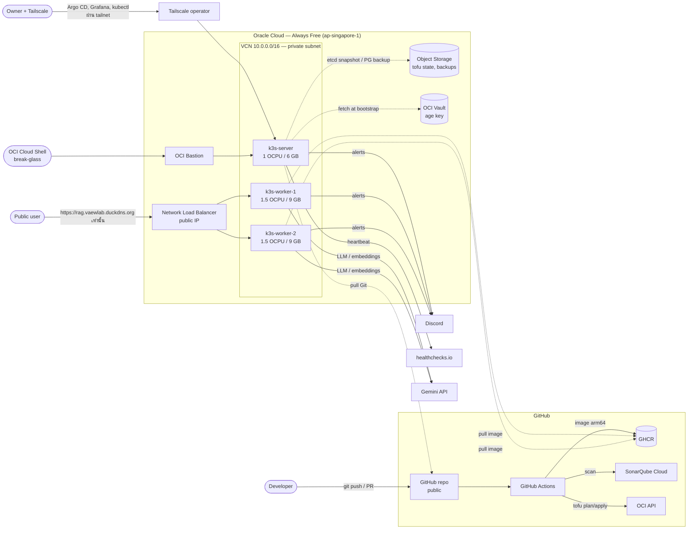
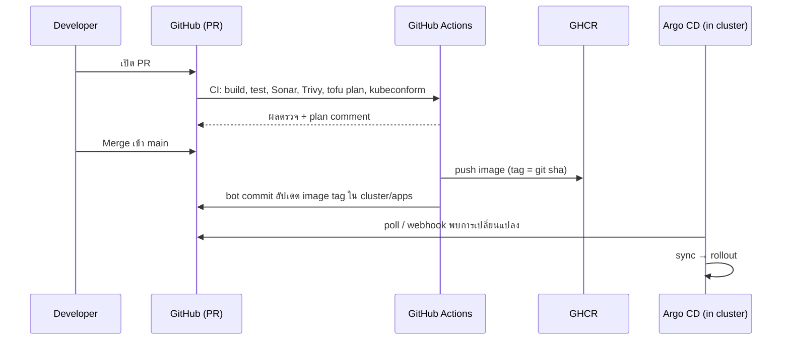
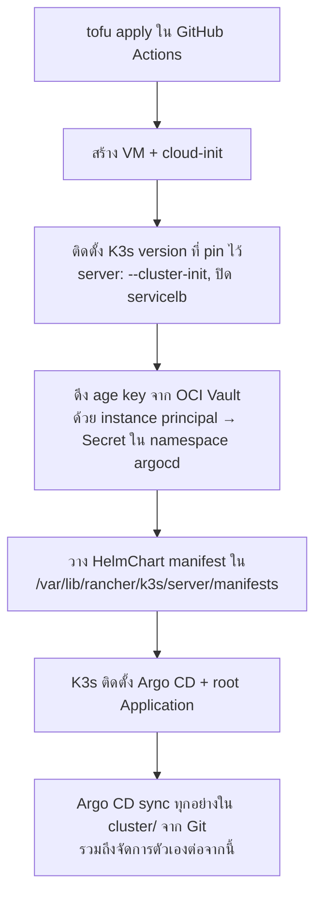
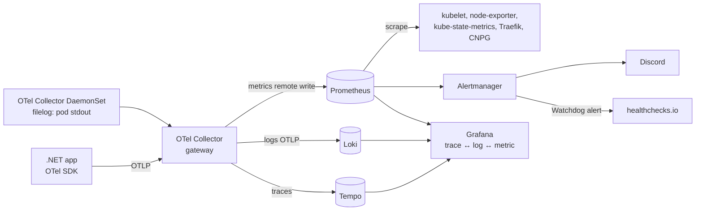

# vaewprach-lab

Personal Lab สำหรับฝึกวาง **Infrastructure, CI/CD และ Observability แบบที่ใช้จริงใน Production** โดยมี POC ต่างๆ (เริ่มจาก RAG) เป็น workload ให้ระบบมีของจริงให้ deploy, monitor และ alert

> สถานะ: **Design / Plan** — เอกสารนี้คือแผนเพื่อทำความเข้าใจร่วมกัน ยังไม่มีการ implement

## หลักการของ Lab

| หลักการ | ความหมาย |
|---|---|
| **Cloud only** | ไม่มีอะไรรันบนเครื่อง local — ทุกการเปลี่ยนแปลงไปผ่าน Git → CI/CD → Cloud |
| **ฟรีให้มากที่สุด** | ใช้ Oracle Cloud Always Free + บริการ SaaS ที่ฟรีสำหรับ public repo — เป้าหมายค่าใช้จ่าย **$0/เดือน** |
| **Production-like** | ใช้ tools และ practice เดียวกับที่บริษัทใช้จริง (IaC, GitOps, SSO, alerting, backup) |
| **เข้าใจทุก setting** | ทุก tool ตั้งค่าเองผ่าน code ไม่ใช้ค่า default แบบไม่รู้ที่มา — แต่ละ phase มีหัวข้อ "ได้เรียนรู้อะไร" |
| **Everything as Code** | Infra = OpenTofu, Cluster = Helm + Argo CD, Secret = SOPS, Pipeline = GitHub Actions |
| **เพิ่ม POC ได้เรื่อยๆ** | POC ใหม่ = โฟลเดอร์ใหม่ + ใช้ pipeline/chart แม่แบบเดิม ไม่ต้องแตะ platform |
| **Secure by default (public repo)** | สมมติว่า **ทุกคนอ่าน repo, CI log และ artifact ได้** — ไม่มี secret ใน Git แบบไม่เข้ารหัส, admin UI ไม่เปิด public, security baseline ทำตั้งแต่ Phase 0 ไม่ใช่ทำทีหลัง (ดู [Security](#security)) |

---

## ภาพรวม Architecture



### Flow การ deploy (GitOps)



**สำคัญ:** CI **ไม่มีสิทธิ์เข้าถึง Kubernetes** — Argo CD เป็นฝ่าย pull จาก Git เอง (pull-based GitOps) ลด attack surface และ cluster state ตรงกับ Git เสมอ

---

## Tool Stack

| Layer | Tool | ฟรีเพราะ | ใช้ทำอะไร / ทำไมเลือก |
|---|---|---|---|
| Project Management | GitHub Projects | ฟรี | Issue, Kanban, roadmap ของแต่ละ phase |
| Source Control | GitHub (public repo) | ฟรี | PR, branch protection, CODEOWNERS |
| CI | GitHub Actions | public repo = ไม่จำกัดนาที, มี `ubuntu-24.04-arm` runner ฟรี | build/test/scan — build arm64 แบบ native ไม่ต้องใช้ QEMU |
| Dependency Update | Renovate (GitHub App) | ฟรี | เปิด PR อัปเดต chart / image / provider version อัตโนมัติ |
| Unit / Integration Test | xUnit + Testcontainers | ฟรี | Testcontainers รันบน GitHub runner (มี Docker) ไม่ใช่ local |
| Code Quality | SonarQube Cloud | ฟรีสำหรับ public project | Static analysis + PR decoration (รุ่น Community self-host ทำ PR analysis ไม่ได้ และกิน RAM 2–4 GB) |
| Security Scan | Trivy | ฟรี | scan image, IaC misconfig (OpenTofu, K8s manifest), SBOM |
| Container Registry | GHCR | public package ฟรี | เก็บ image |
| Infrastructure as Code | OpenTofu | open source (MPL) | provision OCI ทั้งหมด, มี state encryption ในตัว |
| Cloud | Oracle Cloud Always Free | ฟรีถาวร | Ampere A1 รวม 4 OCPU / 24 GB, block 200 GB, NLB, Object Storage, Vault, Bastion |
| Container Orchestration | K3s (embedded etcd) | open source | Kubernetes ที่เบา เห็นทุกชั้นตั้งแต่ติดตั้ง cluster |
| Ingress | Traefik (มากับ K3s) | ฟรี | routing + TLS termination (ไม่ใช้ ingress-nginx เพราะถูก retire ไปแล้ว มี.ค. 2026) |
| TLS | cert-manager + Let's Encrypt (DNS-01) | ฟรี | wildcard cert `*.vaewlab.duckdns.org` ต่ออายุอัตโนมัติ |
| DNS | DuckDNS | ฟรี | `vaewlab.duckdns.org` — เปลี่ยนเป็น domain จริงได้ภายหลังโดยแก้ตัวแปรเดียว |
| CD / GitOps | Argo CD (app-of-apps) | ฟรี | sync cluster จาก Git, rollback ด้วย `git revert` |
| Configuration | Helm | ฟรี | package ทุก component + chart แม่แบบสำหรับ POC |
| Secrets | SOPS + age (ผ่าน KSOPS ใน Argo CD) | ฟรี | secret เข้ารหัสใน Git ได้; age private key เก็บใน OCI Vault |
| Database | PostgreSQL ผ่าน CloudNativePG + pgvector | ฟรี | operator แบบ production (backup, PITR, failover) และใช้เป็น vector DB ของ RAG |
| Metrics | Prometheus (kube-prometheus-stack) | ฟรี | metrics ของ node, pod, app + recording/alert rules |
| Dashboard | Grafana OSS | ฟรี | dashboard + เชื่อม metrics ↔ logs ↔ traces, login ด้วย GitHub OAuth |
| Logging | Loki | ฟรี | centralized logs (รับ OTLP ได้ตรง) |
| Tracing | OpenTelemetry Collector + Tempo | ฟรี | collector เดียวเก็บ traces, metrics, pod logs — vendor neutral |
| Alerting | Alertmanager → Discord | ฟรี | แจ้งเตือน incident (LINE Notify ปิดบริการแล้ว) |
| Dead man's switch | healthchecks.io | ฟรี | ถ้า cluster ล่มทั้งตัว Alertmanager จะเงียบ — healthchecks.io แจ้งแทน |
| Cluster Upgrade | system-upgrade-controller | ฟรี | upgrade K3s แบบ declarative ผ่าน GitOps |
| Admin Access | Tailscale (Kubernetes operator) | Personal plan ฟรี | Argo CD, Grafana, kubectl เข้าได้เฉพาะใน tailnet — ไม่มี admin UI บน internet |
| Break-glass Access | OCI Cloud Shell + OCI Bastion | ฟรี | ใช้เมื่อ Tailscale ใช้ไม่ได้ — session มีอายุ, ไม่เปิด port 6443/22 สู่ internet |
| Secret leak prevention | GitHub secret scanning + push protection, gitleaks (ใน CI) | ฟรีสำหรับ public repo | บล็อก secret ตั้งแต่ตอน push |
| SAST | CodeQL | ฟรีสำหรับ public repo | หา vulnerability ใน code (.NET) + GitHub Actions workflow |
| Supply chain | cosign (keyless), GitHub artifact attestations, SBOM จาก Trivy | ฟรี | พิสูจน์ได้ว่า image มาจาก pipeline นี้จริง |
| CI hardening | StepSecurity harden-runner, OpenSSF Scorecard | ฟรีสำหรับ public repo | ตรวจ egress ของ runner, ให้คะแนน security posture ของ repo |
| Cloud posture | OCI Cloud Guard + Audit log | ฟรี | ตรวจ misconfiguration และเก็บ log การเรียก API ทั้งหมด |
| LLM (POC) | Gemini API free tier | ฟรีตามโควตา | generation + embeddings; ผ่าน abstraction เปลี่ยน provider ได้ |

---

## Infrastructure บน OCI (OpenTofu)

### Compute — ใช้ Always Free A1 ครบโควตาพอดี

| Node | Shape | OCPU / RAM | Boot volume | หน้าที่ |
|---|---|---|---|---|
| `k3s-server` | VM.Standard.A1.Flex | 1 / 6 GB | 60 GB | control plane (etcd), Argo CD |
| `k3s-worker-1` | VM.Standard.A1.Flex | 1.5 / 9 GB | 60 GB | workloads |
| `k3s-worker-2` | VM.Standard.A1.Flex | 1.5 / 9 GB | 60 GB | workloads |
| **รวม** | | **4 / 24 GB** | **180 / 200 GB** | |

- OS: Ubuntu 24.04 (arm64)
- Bootstrap ด้วย **cloud-init** ทั้งหมด — ไม่มีการ SSH เข้าไปตั้งค่ามือ
- Storage: K3s `local-path` provisioner บน boot volume (Always Free block volume ขั้นต่ำ 50 GB ไม่พอแบ่ง) — ชดเชยด้วย backup ไป Object Storage

### Network

| Resource | ค่า | เหตุผล |
|---|---|---|
| VCN | `10.0.0.0/16` | |
| Public subnet | `10.0.0.0/24` | มีแค่ Network Load Balancer |
| Private subnet | `10.0.1.0/24` | node ทั้ง 3 ตัว — ไม่มี public IP |
| NAT Gateway | | ให้ node ออก internet (pull image, เรียก Gemini) |
| Service Gateway | | node คุยกับ Object Storage/Vault โดยไม่ออก internet |
| Network Load Balancer | TCP 80/443 → NodePort ของ Traefik บน worker | L4, TLS จบที่ Traefik |
| NSG / Security List | ingress เฉพาะ 80/443 จาก NLB; ภายใน subnet เปิดเฉพาะ port ที่ K3s ใช้ | least privilege |
| OCI Bastion | port-forward session ไป `k3s-server:6443` | break-glass — ปกติใช้ Tailscale |

> ต้องตรวจตอน Phase 1 ว่า NAT Gateway ใช้ได้ใน account แบบ Always Free — ถ้าไม่ได้ fallback คือ node อยู่ public subnet + NSG ปิดทุก port ขาเข้า

### IAM / Identity

- **CI ใช้ 2 identity แยกกัน:** `ci-plan` (read-only, ใช้ตอน PR) และ `ci-apply` (manage เฉพาะ compartment `vaewprach-lab`, ใช้ได้เฉพาะ Environment `production` ที่ต้อง approve) — ทดลองใช้ **OIDC (workload identity federation)** แทน API key ก่อน; ถ้าทำไม่ได้ใช้ API key + rotate ทุก 90 วัน
- **Dynamic group** ของ node + policy ให้ (1) อ่าน secret จาก Vault (age key) (2) เขียน bucket backup — ใช้ **instance principal** ไม่ต้องฝาก credential บนเครื่อง
- ทุก resource อยู่ใน compartment `vaewprach-lab` และติด tag `project=vaewprach-lab`

### Object Storage (Always Free ~20 GB, ~50k requests/เดือน)

| Bucket | ใช้เก็บ | ความถี่เขียน |
|---|---|---|
| `tofu-state` | OpenTofu state (S3-compatible backend, encrypted) | ตอน apply |
| `backups` | K3s etcd snapshot (ทุก 12 ชม.), CloudNativePG base backup + WAL | ต่ำ |

> Loki และ Tempo ใช้ **filesystem (PVC) + retention 7 วัน** แทน Object Storage เพราะ chunk flush จะใช้ API request เกินโควตาฟรี — ใน production จริงจะใช้ object storage ซึ่งเปลี่ยนได้ด้วยการแก้ values ภายหลัง

### Cluster Bootstrap (ไม่มี local, ไม่มี SSH)



---

## Platform ใน Cluster (จัดการด้วย Argo CD)

### Namespaces

| Namespace | Components |
|---|---|
| `argocd` | Argo CD (+ KSOPS, SSO ผ่าน GitHub) |
| `kube-system` | Traefik, CoreDNS, metrics-server, system-upgrade-controller |
| `cert-manager` | cert-manager + DuckDNS webhook, ClusterIssuer (staging/prod) |
| `monitoring` | Prometheus, Alertmanager, Grafana, node-exporter, kube-state-metrics |
| `observability` | Loki, Tempo, OpenTelemetry Collector (DaemonSet + gateway) |
| `cnpg-system` | CloudNativePG operator |
| `poc-<name>` | แต่ละ POC แยก namespace + ResourceQuota + NetworkPolicy |

### URLs

| URL | Service | เข้าถึงจาก | Auth |
|---|---|---|---|
| `rag.vaewlab.duckdns.org` | RAG POC API | **Internet** (ผ่าน NLB, wildcard cert) | API key + rate limit |
| `argocd.<tailnet>.ts.net` | Argo CD | **Tailnet เท่านั้น** | GitHub SSO (อนุญาตเฉพาะ GitHub user `bookvt`), ปิด local admin |
| `grafana.<tailnet>.ts.net` | Grafana | **Tailnet เท่านั้น** | GitHub OAuth (อนุญาตเฉพาะ GitHub user `bookvt`), ปิด anonymous/sign-up |
| K8s API | kubectl | **Tailnet เท่านั้น** (Tailscale API server proxy) | Tailscale identity → K8s RBAC |

Prometheus / Alertmanager / Loki / Tempo **ไม่เปิดเลย** — ดูผ่าน Grafana. Argo CD ไม่ใช้ GitHub webhook (ต้องเปิด public) แต่ poll Git ทุก 3 นาทีแทน

### Observability Data Flow



### Resource Budget (โดยประมาณ)

| กลุ่ม | RAM |
|---|---|
| K3s system (Traefik, CoreDNS, metrics-server) | ~1 GB |
| Argo CD | ~1 GB |
| kube-prometheus-stack | ~2.5 GB |
| Loki + Tempo (monolithic) | ~1.5 GB |
| OTel Collector (DaemonSet ×3 + gateway) | ~0.6 GB |
| cert-manager, CNPG operator | ~0.3 GB |
| PostgreSQL (1 instance) | ~1 GB |
| RAG POC | ~0.3 GB |
| **รวม** | **~8–9 GB จาก 24 GB** — เหลือที่ให้ POC ถัดไป |

ทุก workload กำหนด `requests/limits` — เป็นส่วนหนึ่งของการฝึก capacity planning

---

## CI/CD Pipelines (GitHub Actions)

| Workflow | Trigger | ขั้นตอน |
|---|---|---|
| `security.yml` | ทุก PR + push + รายสัปดาห์ | gitleaks (ทั้ง history), ตรวจว่าไฟล์ `*.sops.yaml` ถูกเข้ารหัสจริง, CodeQL, zizmor (lint workflow), OpenSSF Scorecard |
| `infra.yml` | PR / push ที่ `infra/**` | `tofu fmt -check` → `validate` → `tflint` → `trivy config` → `plan` ด้วย `ci-plan` (comment เฉพาะสรุป add/change/destroy) → merge: `apply` ด้วย `ci-apply` ผ่าน Environment `production` (ต้องกด approve) → อัปเดต IP ใน DuckDNS |
| `cluster.yml` | PR ที่ `cluster/**` | `helm lint` / `helm template` → `kubeconform` → `trivy config` |
| `poc-*.yml` (เรียก reusable workflow `_dotnet-service.yml`) | PR / push ที่ `pocs/<name>/**` | restore → build → xUnit + Testcontainers → SonarQube Cloud → docker build arm64 → Trivy image (fail ถ้ามี HIGH/CRITICAL ที่ fix ได้) → SBOM → push GHCR (`sha-<commit>`) → cosign sign + attestation → bot commit อัปเดต tag ใน `cluster/apps/<name>` |

**Branch protection (Ruleset) บน `main`:** ต้องผ่าน PR + required checks, ห้าม force push/delete; bot ใช้ GitHub App ที่มีสิทธิ์น้อยที่สุดและ bypass ได้เฉพาะการอัปเดต image tag. กฎ hardening ของทุก workflow อยู่ในหัวข้อ [Security](#security)

### Secrets อยู่ที่ไหน

| Secret | เก็บที่ | ใครใช้ |
|---|---|---|
| Credential ของ `ci-plan` | GitHub Environment `plan` (จำกัดเฉพาะ branch ใน repo — fork ไม่ได้รับ) | `infra.yml` ตอน PR |
| Credential ของ `ci-apply`, S3 credential ของ state bucket, passphrase ของ state encryption | GitHub Environment `production` (เฉพาะ `main` + ต้อง approve) | `infra.yml` ตอน apply |
| Tenancy OCID, region, compartment OCID | GitHub Environment variables (ไม่อยู่ใน code / tfvars) | `infra.yml` |
| `SONAR_TOKEN`, GitHub App key | GitHub secrets | CI |
| DuckDNS token, Gemini API key, Discord webhook, GitHub OAuth secret, healthchecks.io URL | ไฟล์ `*.sops.yaml` ใน Git (เข้ารหัสด้วย age) | Argo CD (KSOPS) |
| age private key | OCI Vault | cloud-init ตอน bootstrap |

---

## Security

Repo เป็น public จึงออกแบบโดยสมมติว่า **code, CI log, artifact, PR comment และ commit history ทุกอันถูกคนทั้งโลกอ่านได้ และอยู่ตลอดไป** (fork และ cache ลบตามไม่ได้)

### Threat Model

| # | ภัยคุกคาม | ตัวอย่าง | การป้องกัน |
|---|---|---|---|
| 1 | **Secret หลุดเข้า Git** | commit `.env`, `*.tfstate`, kubeconfig, age key | push protection + gitleaks ใน CI, `.gitignore` ตั้งแต่ commit แรก, CI ตรวจว่าไฟล์ secret ถูกเข้ารหัสด้วย SOPS จริง, **ถ้าหลุด = rotate ทันที** (ลบ history อย่างเดียวไม่พอ) |
| 2 | **Secret หลุดผ่าน CI log/artifact** | `tofu plan` พิมพ์ค่าลับ, `echo $TOKEN` | ตัวแปรลับเป็น `sensitive = true`, `::add-mask::`, PR comment มีแค่สรุป plan, ไม่ upload state/plan file เป็น artifact |
| 3 | **PR จาก fork ขโมย secret / รัน code** | "pwn request" ผ่าน `pull_request_target` | **ห้ามใช้ `pull_request_target` และ `workflow_run`** กับ code จาก fork, ตั้ง "Require approval for all outside collaborators", fork PR ไม่ได้รับ secret และไม่มี environment |
| 4 | **Third-party Action ถูก compromise** | กรณี `tj-actions/changed-files` (มี.ค. 2025) | pin ทุก action ด้วย **full commit SHA** (Renovate อัปเดตให้), `GITHUB_TOKEN` default = read-only + กำหนด `permissions:` ราย job, harden-runner ตรวจ egress |
| 5 | **Credential cloud หลุด = ยึด infra** | API key ของ CI รั่ว | แยก `ci-plan` (read-only) / `ci-apply` (approve ก่อน), จำกัดสิทธิ์แค่ compartment เดียว, OIDC แทน key ถ้าทำได้, budget alert, Cloud Guard + Audit log |
| 6 | **Admin UI ถูกโจมตีจาก internet** | brute force Grafana / Argo CD, CVE ใน UI | **ไม่เปิดสู่ internet** — เข้าผ่าน Tailscale เท่านั้น + SSO จำกัด user + ปิด local admin |
| 7 | **Public endpoint ถูกใช้ผิดวิธี** | spam `/ask` จนโควตา Gemini หมด | API key + rate limit (Traefik middleware) + request size limit + alert เมื่อ traffic ผิดปกติ |
| 8 | **Image / dependency มีช่องโหว่หรือถูกปลอม** | base image มี CVE, image ถูกแทนที่ใน registry | Trivy gate, SBOM, cosign sign + attestation, base image แบบ distroless/chiseled, deploy ด้วย tag `sha-*` (ไม่ใช้ `latest`) |
| 9 | **Container ถูกเจาะแล้วขยายผล** | pod ที่ถูกเจาะไปอ่าน secret / คุยกับ DB ตัวอื่น | NetworkPolicy default-deny, Pod Security Standard `restricted`, non-root + read-only rootfs, ไม่ mount ServiceAccount token ถ้าไม่จำเป็น, K3s `--secrets-encryption` |
| 10 | **บัญชีเจ้าของถูกยึด** | phishing รหัส GitHub / OCI | **passkey หรือ hardware key** สำหรับ GitHub, OCI และ Tailscale, ไม่ใช้ root/admin account ทำงานประจำ |

### สิ่งที่ "public ได้" และ "ห้าม public"

| Public ได้ (รู้แล้วก็ไม่ช่วยผู้โจมตีมาก) | ห้าม public |
|---|---|
| โครงสร้าง infra, Helm values, workflow | API key, token, password, private key ทุกชนิด |
| age **public** key, ไฟล์ `*.sops.yaml` ที่เข้ารหัสแล้ว | age **private** key, `*.tfstate`, kubeconfig |
| domain `rag.vaewlab.duckdns.org` | Tenancy/user OCID, IP ของ node, ชื่อ tailnet |

### Security baseline ต่อ phase

Security ไม่ใช่ phase สุดท้าย — แต่ละ phase ต้องผ่าน baseline ของตัวเองก่อนถือว่า Done (ดูคอลัมน์ Security ใน [Roadmap](#roadmap))

---

## โครงสร้าง Repo (เป้าหมาย)

```
.
├── README.md
├── SECURITY.md                     # วิธีแจ้งช่องโหว่ (private vulnerability reporting)
├── renovate.json
├── .gitignore                      # *.tfstate, *.tfvars, .env, kubeconfig, *.agekey ฯลฯ
├── .sops.yaml                      # กฎการเข้ารหัส (age public key)
├── .github/
│   ├── CODEOWNERS
│   └── workflows/                  # security.yml, infra.yml, cluster.yml, _dotnet-service.yml, poc-*.yml
├── docs/
│   └── adr/                        # Architecture Decision Records
├── infra/                          # OpenTofu
│   ├── modules/
│   │   ├── network/                # VCN, subnets, gateways, NSG
│   │   ├── k3s-cluster/            # instances + cloud-init templates
│   │   ├── load-balancer/          # NLB
│   │   ├── iam/                    # compartment, dynamic group, policies
│   │   └── storage/                # buckets, vault
│   └── live/                       # root module: backend, providers, เรียก modules
├── cluster/                        # ทุกอย่างที่ Argo CD sync
│   ├── bootstrap/                  # root Application (app-of-apps)
│   ├── platform/                   # argocd, cert-manager, monitoring, loki, tempo, otel, cnpg, upgrades
│   └── apps/                       # Application ของแต่ละ POC + values
├── charts/
│   └── poc-service/                # Helm chart แม่แบบสำหรับ POC
└── pocs/
    └── rag/                        # src/, tests/, Dockerfile
```

### เพิ่ม POC ใหม่

1. สร้าง `pocs/<name>/` (code + tests + Dockerfile)
2. เพิ่ม `.github/workflows/poc-<name>.yml` ที่เรียก reusable workflow
3. เพิ่ม `cluster/apps/<name>/` (Application + values ของ `charts/poc-service`)
4. (ถ้ามี) dashboard / alert rule ของ POC นั้น

---

## Roadmap

แต่ละ phase จบด้วยสิ่งที่ตรวจได้จริงบน cloud

| Phase | งาน | ได้เรียนรู้ | Security baseline | Done เมื่อ |
|---|---|---|---|---|
| **0. Accounts + Repo security** (ทำมือครั้งเดียว) | ไฟล์ hygiene + security workflows, ตั้งค่า GitHub แล้วเปลี่ยน repo เป็น public; สมัคร OCI (home region `ap-singapore-1`), upgrade เป็น Pay-As-You-Go + budget alert $1, เปิด Cloud Guard; สร้าง `ci-plan` / `ci-apply`, bucket `tofu-state`, Environments `plan` / `production` (SaaS อื่นสมัครใน phase ที่ใช้) | account hygiene, least privilege | passkey/MFA ทุกบัญชี, secret scanning + push protection, Ruleset บน `main`, require approval สำหรับ fork PR, `GITHUB_TOKEN` read-only, `.gitignore`, `SECURITY.md`, `security.yml` | `security.yml` ผ่าน, Scorecard มีคะแนนตั้งต้น |
| **1. Foundation** | OpenTofu: IAM, network, NLB, 3 VM; pipeline `infra.yml` | IaC, remote state + encryption, plan/apply workflow, OCI networking | node ไม่มี public IP, NSG เปิดแค่ 80/443 จาก NLB, state encrypted, plan ไม่รั่วค่าลับใน log | `tofu apply` จาก Actions สร้าง VM ได้, plan summary ใน PR |
| **2. Cluster + GitOps** | cloud-init ติดตั้ง K3s, age key ใน OCI Vault, Argo CD + KSOPS + root app, Tailscale operator | Kubernetes bootstrap, etcd, app-of-apps | `--secrets-encryption`, API server เข้าได้ทาง tailnet/bastion เท่านั้น | Argo CD sync `cluster/` ได้, kubectl ผ่าน Tailscale ได้ |
| **3. Ingress, TLS, SSO** | Traefik config, cert-manager + DuckDNS, SSO ของ Argo CD | TLS automation, DNS-01, secret management | ปิด Argo CD local admin, security headers ใน Traefik, NetworkPolicy default-deny + PSS `restricted` ทุก namespace ใหม่ | wildcard cert valid, Argo CD login ด้วย GitHub ผ่าน tailnet |
| **4. Observability** | kube-prometheus-stack, Loki, Tempo, OTel Collector, Alertmanager → Discord, Watchdog → healthchecks.io | metrics/logs/traces, PromQL, LogQL, alert routing | Grafana อยู่ใน tailnet เท่านั้น, alert เมื่อมี login ล้มเหลวหรือ traffic ผิดปกติ | dashboard มีข้อมูล, ทดสอบ alert เข้า Discord ได้ |
| **5. Data** | CloudNativePG + pgvector, backup ไป Object Storage | DB operator, backup/restore, PITR | DB ไม่เปิดนอก namespace, credential ต่อ app, backup เข้ารหัส | restore จาก backup สำเร็จ (ทดสอบจริง) |
| **6. App CI template** | reusable workflow .NET, chart `poc-service`, Renovate | test pyramid, quality gate, supply chain security | Trivy gate, SBOM, cosign + attestation, non-root distroless image | service ตัวอย่างไหลจาก PR → GHCR → cluster อัตโนมัติ |
| **7. POC: RAG** | .NET 10 Minimal API: `/ingest`, `/ask` + pgvector + Gemini, instrument ด้วย OTel | RAG pipeline, observability ของ LLM app (latency, token, error) | API key + rate limit + request size limit, `/ingest` ไม่เปิด public | ถามคำถามผ่าน `rag.vaewlab.duckdns.org` ได้ และเห็น trace ครบใน Grafana |
| **8. Operations** | K3s upgrade ผ่าน system-upgrade-controller, SLO + burn-rate alert, game day (ปิด node ดูว่าเกิดอะไร), (optional) Kyverno ตรวจ signature ของ image ก่อน deploy | operations จริง | ทดสอบ rotate secret ทุกตัวได้จริง | มี runbook ใน `docs/` |

POC แต่ละตัว (รวม RAG) จะมี design ของตัวเองแยกต่างหากก่อนเริ่มทำ

---

## Decisions ที่เลือกแล้ว (และทางที่ไม่เลือก)

| เรื่อง | เลือก | ไม่เลือก เพราะ |
|---|---|---|
| Cloud | Oracle Always Free | AWS/GCP/Azure: node เสียเงิน ~$50–150/เดือน, credit ฟรีมีอายุ |
| Kubernetes | K3s | OKE: ใช้ได้แต่ซ่อน control plane — lab นี้อยากเห็นทุกชั้น, ย้ายไป managed ทีหลังได้ |
| IaC | OpenTofu | Terraform: license BSL, OpenTofu มี state encryption ในตัว |
| Secrets | SOPS + age | External Secrets + OCI Vault: ผูกกับ cloud มากกว่า (เพิ่มภายหลังได้) |
| Code quality | SonarQube Cloud | SonarQube Community self-host: กิน RAM 2–4 GB และไม่มี PR analysis |
| Vector DB | pgvector | Qdrant: เพิ่ม component และ RAM โดยไม่จำเป็นในระดับ POC |
| Log collector | OTel Collector | Promtail: EOL แล้ว; Alloy: ใช้ได้ แต่ OTel เป็นมาตรฐานกลางที่ใช้ข้าม vendor |
| Loki/Tempo storage | Filesystem + retention 7 วัน | Object Storage: request เกินโควตาฟรี |
| DNS | DuckDNS | ซื้อ domain (~$10/ปี): ได้ฝึก ExternalDNS — ทำภายหลังได้ |
| Repo | Public + hardening ตาม [Security](#security) | Private: Actions จำกัด 2,000 นาที/เดือน และ **เสีย** secret scanning / push protection / CodeQL ฟรีไป — public ที่ hardening ดีจึงปลอดภัยกว่า private ที่ไม่มีเครื่องมือตรวจ |
| Admin access | Tailscale (UI ไม่อยู่บน internet) | SSO อย่างเดียวบน public URL: ยังโดน brute force / CVE ของ UI ได้ |

## ความเสี่ยงที่รู้อยู่แล้ว

| ความเสี่ยง | การรับมือ |
|---|---|
| A1 "Out of capacity" ตอนสร้าง VM | รัน `apply` ซ้ำ; ถ้าเรื้อรังลองเปลี่ยน availability domain |
| Always Free instance ที่ idle ถูก reclaim | upgrade เป็น Pay-As-You-Go (resource Always Free ยังฟรี) + budget alert |
| เผลอสร้าง resource ที่เสียเงิน | budget alert $1, ใช้เฉพาะ shape A1, review `tofu plan` ทุกครั้ง |
| `k3s-server` ตัวเดียว = single point of failure | etcd snapshot ไป Object Storage + ทดสอบ restore; รับได้สำหรับ lab |
| Secret หลุดเข้า public repo | push protection + gitleaks; ถ้าหลุดให้ rotate ก่อน แล้วค่อยลบออกจาก history |
| Tailscale ล่ม / account ใช้ไม่ได้ | break-glass ผ่าน OCI Cloud Shell + Bastion |
| โควตา free tier ของ provider เปลี่ยน | ทุกอย่างเป็น code — ย้าย provider โดยแก้แค่ `infra/` |
